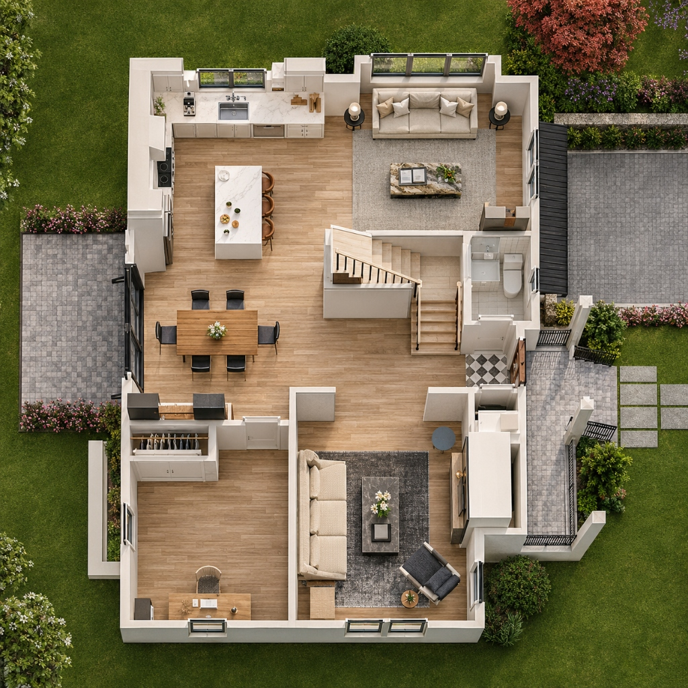
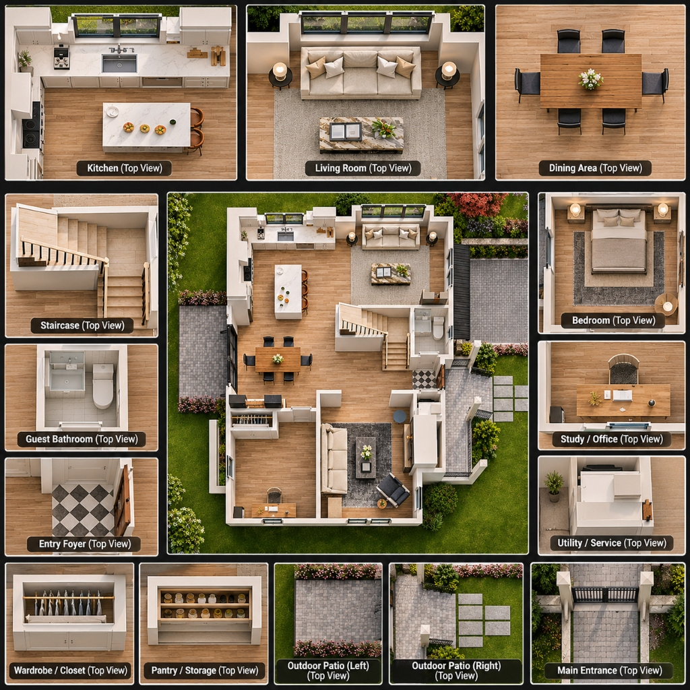

# 🏡 Modern Luxury Residence — 3D Architectural Visualization

[](https://threejs.org/)
[](https://vitejs.dev/)
[](https://www.khronos.org/webgl/)
[](LICENSE)

A photorealistic, interactive 3D architectural floor plan visualization built with **Three.js**, **Vite**, and **WebGL**. This application accurately recreates a luxury single-story villa floor plan with isometric cutaway view, physically based rendering (PBR), realistic lighting, ambient occlusion contact shadows, and an interactive glassmorphic UI.

---

## 📸 Showcase


---

## 🔍 Side-by-Side Comparison

| Original Reference Floor Plan | Recreated Interactive 3D WebGL Model |
| :---: | :---: |
|  |  |

### Detailed Reference Callout Board
The model was meticulously engineered to match every single specification from the architectural callout sheet:

<p align="center">
  
</p>

---

## ✨ Key Features & Room Highlights

### 🍳 1. Kitchen & Waterfall Marble Island
- **Countertops**: Calacatta Gold marble countertops with dual waterfall edges on the central prep island.
- **Bar Stools**: 3 round cognac leather bar stools with black slender steel legs.
- **Accessories**: White porcelain fruit bowl with lemons and oranges, corner espresso machine, chef cutting board, and wooden knife block.
- **Pantry Storage**: Built-in recessed double-shelf pantry unit with two rows of spice jars with wooden lids (`Pantry / Storage` callout).
- **Appliances**: 4-burner black ceramic cooktop with stainless steel chimney range hood and double undermount sink with high-arc gooseneck faucet.

### ☀️ 2. Sunroom / Upper Living Lounge
- **Seating**: 3-seater plush cream linen sofa styled with 4 accent pillows (2 camel, 2 ivory).
- **Lighting**: Flanking dark wood round side tables with warm glowing spherical globe lamps.
- **Coffee Table**: Marble coffee table with open art books and a miniature succulent planter.
- **Glazing**: 4-panel panoramic black-framed windows overlooking the surrounding landscaped garden.

### 🍽️ 3. Dining Area
- **Table**: Solid rectangular natural blonde honey oak dining table ($2.3\text{m} \times 1.15\text{m}$) with chamfered edge profile.
- **Seating**: 6 Scandinavian dining chairs with black curved backrests and cushioned seats (2 North, 2 South, 1 West, 1 East).
- **Centerpiece**: Low white ceramic bowl with blooming white flowers.
- **Terrace Access**: Floor-to-ceiling sliding glass doors opening directly onto the west slate patio.

### 🛋️ 4. Lower Living Room / Sitting Lounge
- **Sofa**: Modular 3-seater cream sectional sofa.
- **Carpet**: Distressed vintage dark charcoal/navy area rug with decorative perimeter borders.
- **Accents**: Dark stone coffee table with flower vase and art books, modern dark charcoal lounge chair on angled chrome legs, low media credenza, and a cylindrical blue ceramic umbrella/drink stand.

### 🚪 5. Entry Foyer
- **Flooring**: **High-contrast diagonal black-and-white diamond checkerboard tile floor** matching the `Entry Foyer (Top View)` callout.
- **Door**: Solid blonde oak entrance door with brushed chrome hardware, open ajar at 45°.

### 🪜 6. Split-Level Staircase
- **Architecture**: U-shaped split-level stairs with solid white stringer base, blonde oak tread caps, intermediate landing platform, vertical black metal balusters, and a smooth oak handrail.

### 🚿 7. Guest Bathroom
- **Fixtures**: Modern white porcelain toilet with cistern, floating vanity with integrated rectangular ceramic basin and chrome faucet, LED backlit vanity mirror, and frameless walk-in glass shower with rain showerhead.

### 💻 8. Master Study & Built-in Wardrobe
- **Closet**: Built-in open wardrobe with lower white storage cabinet and an upper chrome rail holding 12 colorful hanging garments (`Wardrobe / Closet (Top View)` callout).
- **Executive Desk**: Natural blonde oak desk facing the south window, complete with ultrawide monitor, desk lamp, and an ergonomic curved-back swivel chair.

### 🌿 9. Outdoor Patios & Landscaping
- **West Patio**: Slate cobblestone terrace enclosed on three sides by dense manicured hedges dotted with **vibrant pink flower blossoms**.
- **Front Veranda & Driveway**: Slate flagstone courtyard, dark paved driveway, black steel pergola awning casting crisp linear slat shadows, stone gateposts with wrought-iron gates, and **5 rectangular stepping stones** across the lawn.
- **Flora**: Deep crimson Japanese Maple tree (*Acer palmatum*), perimeter deciduous trees, and foundation shrubs.

---

## 🎨 Rendering & Lighting Architecture

- **PBR Color Calibration**: All diffuse maps strictly use `THREE.SRGBColorSpace` with $16\times$ anisotropic filtering, preventing gamma wash-out and rendering true saturated wood and lawn tones.
- **Procedural Canvas Textures**:
  - Horizontal blonde honey oak wood planks with micro-beveled seams, grain variations, and clearcoat sheen (`MeshPhysicalMaterial`).
  - Calacatta Gold marble with cloudy veining.
  - High-contrast black & white diagonal diamond checkerboard tiles.
  - Slate cobblestone pavers with randomized mortar joints.
  - Deep forest-olive lawn turf with 70,000 organic grass blade flecks.
- **Directional Sunlight & Shadows**: $2.3$ intensity direct sunlight shining from the North-West $(-18, 28, -14)$ with a $4096 \times 4096$ soft PCF shadow map (`bias: -0.0001`, `normalBias: 0.02`).
- **Ground Truth Ambient Occlusion (GTAO)**: Real-time screen-space contact shadows (`blendIntensity: 0.85`, `radius: 0.45`) anchoring all furniture legs and baseboards to the floor.
- **Post-Processing Pipeline**: `EffectComposer` utilizing `RenderPass`, `GTAOPass`, `OutputPass` (ACES Filmic Tone Mapping), and `ShaderPass` (FXAA Anti-Aliasing).

---

## 🎮 Interactive Controls & UI

| Control | Description |
| :--- | :--- |
| **Orbit Controls** | **Left Click + Drag** to rotate, **Right Click + Drag** to pan, **Scroll Wheel** to zoom |
| **Lighting Modes** | Toggle between **☀️ Day**, **🌅 Sunset**, and **🌙 Night** lighting presets |
| **Cutaway Slider** | Adjust the interactive cutaway wall height dynamically from $0.2\text{m}$ to $2.8\text{m}$ |
| **Camera Presets** | One-click transitions to **Photo Isometric**, **2D Blueprint**, or individual room views |
| **🚶 Walkthrough FPS** | Immersive first-person mode: Use <kbd>W</kbd><kbd>A</kbd><kbd>S</kbd><kbd>D</kbd> to walk, mouse to look, and <kbd>ESC</kbd> to exit |
| **📸 Export Image** | Download instant high-resolution PNG screenshots with a single click |

---

## 🚀 Getting Started

### Prerequisites
- [Node.js](https://nodejs.org/) (version 18 or higher recommended)
- `npm` or `yarn`

### Installation & Local Run

1. **Clone the repository:**
   ```bash
   git clone https://github.com/dhyeykhanpara21/3d-floor-block.git
   cd 3d-floor-block
   ```

2. **Install dependencies:**
   ```bash
   npm install
   ```

3. **Start the development server:**
   ```bash
   npm run dev
   ```
   Open **[http://localhost:5173/](http://localhost:5173/)** in your browser.

4. **One-Click Windows Launcher:**
   Double-click `start.bat` in the project root to automatically install dependencies and launch the app.

### Production Build

To compile the application for deployment (e.g. on Vercel, Netlify, or GitHub Pages):

```bash
npm run build
```

Preview the production build locally:

```bash
npm run preview
```

---

## 🧊 Blender 4.x Procedural Generator Script

The repository includes a companion procedural Python generator script for Blender Cycles / EEVEE:
- **Script**: [`modern_luxury_villa_generator.py`](modern_luxury_villa_generator.py)
- **Documentation**: [`README_villa_model.txt`](README_villa_model.txt)

### How to Run in Blender:
1. Open **Blender 4.0+**.
2. Switch to the **Scripting** workspace tab.
3. Open `modern_luxury_villa_generator.py` and click **Run Script** (<kbd>Alt</kbd> + <kbd>P</kbd>).
4. The entire villa geometry, materials, and 7 pre-aligned camera views will be generated automatically.
5. Press <kbd>F12</kbd> to render the high-resolution isometric view.

---

## 📁 Repository Structure

```
3d-room-design/
├── docs/                             # Showcase documentation assets
│   ├── preview.png                   # High-res photorealistic WebGL render
│   ├── reference_design.jpg          # Original architectural reference floor plan
│   └── reference_callouts.jpg        # Detailed room callout sheet
├── src/
│   ├── main.js                       # Main application entry point & animation loop
│   ├── house.js                      # Architectural envelope, floors, cutaway walls & pergola
│   ├── materials.js                  # PBR materials & MeshPhysicalMaterial definitions
│   ├── textures.js                   # Procedural canvas textures (wood, marble, tiles, turf)
│   ├── environment.js                # Sky HDR, post-processing pipeline (GTAO + ACES + FXAA)
│   ├── controls.js                   # Sun/sky lighting controller & FPS walkthrough mode
│   ├── dimensions.js                 # 3D room dimension labels & area overlays
│   ├── ui.js                         # Glassmorphic HUD, slider, and camera buttons
│   └── rooms/
│       ├── kitchen.js                # Kitchen cabinetry, waterfall island, stools & pantry
│       ├── dining.js                 # Oak dining table & 6 Scandinavian chairs
│       ├── sunroom.js                # Sunroom sofa, globe lamps & marble coffee table
│       ├── living.js                 # Lower living room sectional, vintage rug & media credenza
│       ├── staircase.js              # Split-level U-stairs with balustrade
│       ├── bathroom.js               # Porcelain fixtures, floating vanity & glass shower
│       ├── office.js                 # Master study desk, ultrawide monitor & built-in closet
│       └── exterior.js               # Japanese maple, deciduous trees, hedges & flowers
├── index.html                        # Glassmorphism HTML layout & CSS styling
├── modern_luxury_villa_generator.py  # Standalone Blender 4.x procedural generator script
├── package.json                      # Project dependencies & npm scripts
├── start.bat                         # One-click Windows launch script
└── README.md                         # Project documentation & visual guide
```

---

## 📜 License

This project is licensed under the MIT License — see the [LICENSE](LICENSE) file for details.
